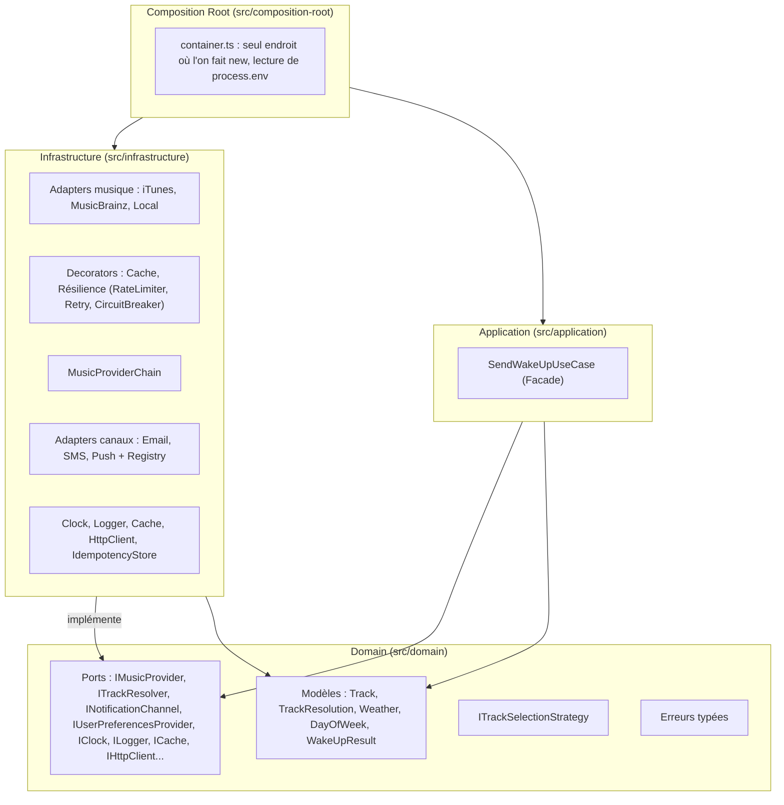
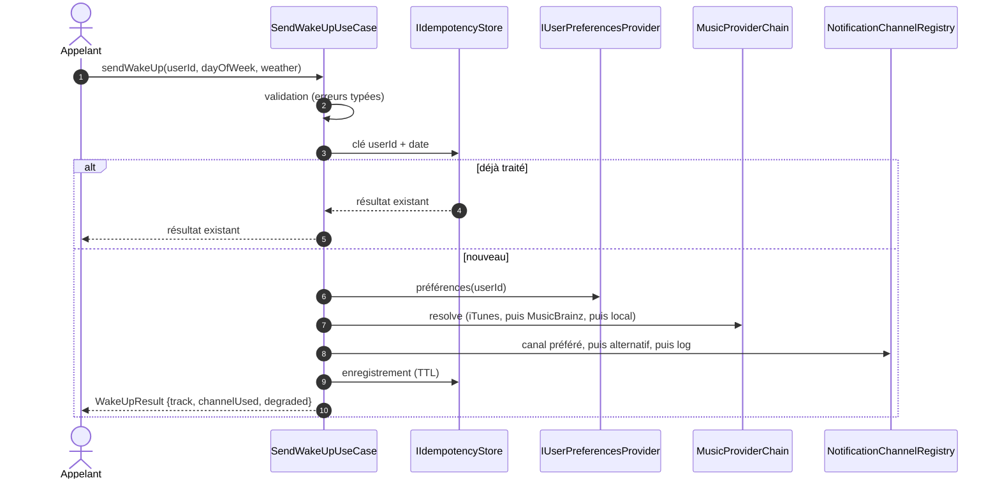

# Réveil Musical

Service de réveil musical résilient, conçu pour une échelle mondiale. Un morceau est choisi selon le jour et la météo, puis notifié sur le canal préféré de l'utilisateur.

Principes : Clean Architecture, dépendances pointant vers le domaine, DI manuelle par constructeur, zéro cycle, « jamais de silence », **0 dépendance de production**.

---

## 1. Architecture et graphe de dépendances

### 1.1 Couches



Règles appliquées automatiquement par `dependency-cruiser` (`npm run deps:check`) :

- aucun cycle ;
- le domaine n'importe ni application, ni infrastructure, ni composition root ;
- le domaine et l'application n'importent aucun package npm ni module natif Node (`core`) : tout passe par des ports ;
- l'application n'importe pas l'infrastructure ;
- l'infrastructure n'importe pas la composition root.

### 1.2 Séquence de `sendWakeUp`



---

## 2. Patterns et problème résolu

| Pattern | Classes | Problème résolu |
| :-- | :-- | :-- |
| Adapter | `ItunesMusicAdapter`, `MusicBrainzMusicAdapter`, `Email/Sms/PushNotificationAdapter` | Les API externes ne correspondent pas au domaine. Les champs propriétaires (`trackViewUrl`, `artist-credit`) restent dans l'adaptateur. |
| Strategy | `ITrackSelectionStrategy` | Remplacer la règle météo/jour/morceau sans toucher au cas d'usage. |
| Registry / Factory | `NotificationChannelRegistry` | Ajouter un canal (WhatsApp, voix) par un enregistrement, sans modifier l'existant (OCP). |
| Facade | `SendWakeUpUseCase` | Orchestrer validation, idempotence, préférences, musique et notification derrière un seul appel. |
| Chain of Responsibility | `MusicProviderChain` | Basculer de fournisseur en cas de panne, et signaler le repli. |
| Decorator | `CachedMusicProviderDecorator`, `ResilientMusicProviderDecorator` | Ajouter cache, rate limit, retry et circuit breaker sans modifier les adaptateurs. |
| Circuit Breaker | `CircuitBreaker` | Échouer vite face à un fournisseur instable (CLOSED, OPEN, HALF_OPEN). |
| Composition Root | `container.ts` | Un seul endroit pour instancier et injecter, y compris les durées de vie (singletons : config, cache, circuit breakers). |

---

## 3. Fiabilité et mode dégradé

Le réveil part toujours : une panne de fournisseur ou de canal ne produit jamais de silence.

**Musique** : fournisseurs dans l'ordre configuré (par défaut iTunes, MusicBrainz, catalogue local), chacun protégé par retry avec backoff, circuit breaker et cache. Si toute la chaîne échoue pour la requête, le morceau de secours de l'utilisateur est essayé.

**Canaux** : canal préféré, puis canal de secours de l'utilisateur, puis tout autre canal enregistré, puis journalisation structurée (`LOG_FALLBACK`).

Le champ `degraded` du résultat vaut `true` lorsque :

- un fournisseur musical autre que le premier de la chaîne a répondu ;
- le morceau de secours de l'utilisateur a dû être utilisé après un échec de la chaîne ;
- le canal préféré a échoué et un autre canal a été utilisé.

Une météo non couverte par les préférences de l'utilisateur n'est **pas** un mode dégradé : le morceau de secours prévu pour ce cas est un comportement métier normal.

**Idempotence** : une clé `userId + date locale` évite un double envoi le même jour (durée configurable).

---

## 4. Configuration

La configuration est lue **une seule fois**, dans la composition root (`process.env`), validée au démarrage (`parseAndValidateConfig`), puis injectée sous forme d'objet typé. Aucune autre couche ne lit l'environnement. Une variable absente ou vide utilise la valeur par défaut.

| Variable | Défaut | Rôle |
| :-- | :-- | :-- |
| `MUSIC_PROVIDERS_ORDER` | `itunes,musicbrainz,local` | Ordre de la chaîne de fournisseurs (changement sans recompilation) |
| `MUSICBRAINZ_USER_AGENT` | `MusicalWakeUp/1.0.0 ( contact@example.com )` | User-Agent identifiable exigé par MusicBrainz |
| `ITUNES_RATE_LIMIT_MAX` | `20` | Requêtes max par fenêtre |
| `ITUNES_RATE_LIMIT_WINDOW_MS` | `60000` | Taille de la fenêtre du rate limiter |
| `CB_FAILURE_THRESHOLD` | `5` | Échecs consécutifs avant ouverture du circuit |
| `CB_RESET_TIMEOUT_MS` | `10000` | Délai avant test de guérison (HALF_OPEN) |
| `HTTP_TIMEOUT_MS` | `5000` | Timeout des appels HTTP |
| `CACHE_TTL_SECONDS` | `3600` | Durée de vie du cache des morceaux |
| `IDEMPOTENCY_TTL_SECONDS` | `86400` | Durée de la clé d'idempotence |
| `TIME_ZONE` | `Europe/Paris` | Fuseau horaire explicite |
| `LOCALE` | `fr-FR` | Langue explicite du message |
| `LOG_LEVEL` | `INFO` | `DEBUG`, `INFO`, `WARN` ou `ERROR` |

Le seuil du circuit breaker est à 5 car chaque requête effectue jusqu'à 3 tentatives : un seuil de 3 ouvrirait le circuit dès la première requête en échec.

---

## 5. Supply chain

### 5.1 Production : 0 dépendance

`dependencies: {}`. Seuls des modules natifs sont utilisés (Node ≥ 20) : `fetch`, `node:crypto` (`randomUUID`, dans un adaptateur d'infrastructure), `Intl.DateTimeFormat`. Surface d'attaque et risque de licence nuls en production.

### 5.2 Dépendances directes (développement)

Versions vérifiées avec `npm ls`, `npm outdated` et `npm view <pkg> dist-tags` le 08/10/2026.

| Package | Installée | Dernière stable | Licence | Usage et justification |
| :-- | :-- | :-- | :-- | :-- |
| `typescript` | 5.9.3 | 7.0.2 | Apache-2.0 | **Retard volontaire** : `@typescript-eslint/parser@8.71.1` déclare `typescript >=4.8.4 <6.1.0`. TypeScript 7 casserait le lint. À relever quand typescript-eslint le supportera. |
| `@types/node` | 22.20.5 | 26.6.4 | MIT | **Retard volontaire** : les types restent alignés sur la version de Node ciblée (22 LTS). |
| `vitest` | 5.0.3 | 5.0.3 | MIT | Tests. |
| `@vitest/coverage-v8` | 5.0.3 | 5.0.3 | MIT | Couverture (même version majeure que vitest). |
| `eslint` | 9.39.5 | 9.39.5 | MIT | Linter (flat config). |
| `@typescript-eslint/parser` | 8.71.1 | 8.71.1 | MIT | Parseur TS pour ESLint. |
| `@typescript-eslint/eslint-plugin` | 8.71.1 | 8.71.1 | MIT | Règles TS pour ESLint. |
| `dependency-cruiser` | 16.10.4 | 16.10.4 | MIT | Contrôle des frontières entre couches et des cycles. |
| `license-checker-rseidelsohn` | 4.4.2 | 4.4.2 | BSD-3-Clause | Contrôle des licences de tout l'arbre. |
| `@cyclonedx/cyclonedx-npm` | 6.0.1 | 6.0.1 | Apache-2.0 | Génération du SBOM CycloneDX (`bom.json`). |

### 5.3 Dépendances transitives (développement)

Résultat de `npm run licenses:check -- --summary` : **346 packages**. La commande `npm ls --all` affiche 605 lignes car les doublons et les dépendances partagées y sont comptés plusieurs fois.

| Licence | Packages |
| :-- | --: |
| MIT | 242 |
| ISC | 48 |
| Apache-2.0 | 22 |
| BlueOak-1.0.0 | 10 |
| BSD-2-Clause | 9 |
| BSD-3-Clause | 6 |
| MPL-2.0 | 2 |
| CC0-1.0 | 2 |
| Python-2.0 | 1 |
| (MIT OR WTFPL) | 1 |
| (BSD-2-Clause OR MIT OR Apache-2.0) | 1 |
| CC-BY-3.0 | 1 |
| (MIT AND CC-BY-3.0) | 1 |

Points à justifier :

- **MPL-2.0 (2 packages, dont `lightningcss-linux-x64-gnu`, tiré par Vite/Vitest)** : copyleft **faible, au niveau du fichier**. L'obligation de partage ne porte que sur les fichiers MPL modifiés. Aucun de ces packages n'est modifié, et ils sont dev-only : rien n'est distribué avec l'application.
- **CC-BY-3.0** (seul ou combiné en `MIT AND CC-BY-3.0`) : licence d'attribution portant sur du contenu, dev-only, attribution conservée dans le SBOM.
- **Python-2.0, BlueOak-1.0.0, CC0-1.0** : permissives.
- **Aucune licence GPL, AGPL ni LGPL.**
- `npm audit` : 0 vulnérabilité.

---

## 6. Plan de sortie par fournisseur

Remplacer un fournisseur = **1 adaptateur à écrire + 1 ligne dans `container.ts`**. Le domaine, l'application et les tests de contrat existants ne changent pas.

| Actuel | Remplaçant possible | Fichier à créer | Fichier à modifier |
| :-- | :-- | :-- | :-- |
| iTunes | Spotify | `SpotifyMusicAdapter.ts` | `container.ts` |
| MusicBrainz | Deezer | `DeezerMusicAdapter.ts` | `container.ts` |
| Fallback local | Catalogue SQL / Redis | `DatabaseMusicAdapter.ts` | `container.ts` |
| Email | SendGrid / SES | `SendgridNotificationAdapter.ts` | `container.ts` |
| SMS | Twilio / Infobip | `TwilioNotificationAdapter.ts` | `container.ts` |
| Push | FCM | `FcmNotificationAdapter.ts` | `container.ts` |
| Nouveau canal | WhatsApp Business | `WhatsAppNotificationAdapter.ts` | `container.ts` |

Les coûts sont des estimations : de l'ordre de 0,25 à 0,5 jour par adaptateur, hors gestion des secrets et des quotas du fournisseur.

---

## 7. Risques

| Axe | Niveau | Mesures et réserves |
| :-- | :-: | :-- |
| SPOF | Faible | Cascade musique (iTunes, MusicBrainz, local) et canaux (préféré, alternatif, log). Les caches et l'idempotence en mémoire ne survivent pas à un redémarrage (voir §9). |
| Vendor lock-in | Faible | Aucun type ni champ propriétaire hors des adaptateurs, vérifié par un test d'absence de fuite. Le coût de remplacement est celui d'un adaptateur (§6). |
| Pricing / quotas | Faible | `RateLimiter` à 20 req/min vers iTunes, cache TTL configurable. Les API retenues sont gratuites aujourd'hui mais leurs conditions peuvent changer : le plan de sortie sert à ça. |
| Bus factor (code) | Faible | DI manuelle explicite, pas de framework, règles d'architecture automatisées, tests et README. |
| Bus factor (dépendances) | Faible | 0 dépendance de production. Outils de développement tous maintenus et à licence permissive. |
| Souveraineté / juridiction | Moyen | Apple est soumis au Cloud Act. Seule la requête musicale est envoyée, sans identifiant utilisateur. MusicBrainz (MetaBrainz Foundation) publie ses données sous CC0. Les canaux de notification manipulent des données personnelles : **la conformité RGPD reste à assurer** en choisissant des passerelles hébergées dans l'UE lors du passage en production (les canaux actuels sont des mocks). |

---

## 8. Exécution, démonstration et vérifications

```bash
npm install
npm run build           # compilation TypeScript strict
npm run test            # tests unitaires, contrat, end-to-end (aucun appel réseau)
npm run coverage        # seuil de couverture 85 % (échec si non atteint)
npm run lint
npm run deps:check      # règles d'architecture et cycles
npm run licenses:check  # licences autorisées sur tout l'arbre
npm run audit
npm run sbom            # génère bom.json (CycloneDX)
```

### Démonstration

Le projet est un cœur métier sans interface : `npm run demo -- <userId> <jour> <météo>` appelle `sendWakeUp` et affiche le résultat. Les canaux sont des mocks qui écrivent dans la console.

```bash
npm run demo                                          # user-alice, LUNDI, SOLEIL (email)
npm run demo -- user-bob-partial-weather LUNDI NEIGE  # météo non couverte : morceau de secours, SMS, degraded=false
npm run demo -- user-charlie-push VENDREDI NUAGEUX    # canal push
npm run demo -- inconnu LUNDI SOLEIL                  # utilisateur inconnu : UserNotFoundError
MUSIC_PROVIDERS_ORDER=musicbrainz,local npm run demo  # changement de fournisseur sans recompiler
```

Sans connexion réseau, `npm run demo` montre la cascade complète : iTunes puis MusicBrainz échouent (retries, ouverture des circuits), le catalogue local répond, le réveil part avec `degraded: true`.

---

## 9. Limites connues

1. **Cache et idempotence en mémoire** : valables pour une instance. En multi-instances, fournir une implémentation Redis des ports `ICache` et `IIdempotencyStore`.
2. **Rate limiting local** : le quota de 20 req/min est par instance. Pour un cluster, prévoir un limiteur distribué (Redis).
3. **Pas d'appel météo** : conformément à l'énoncé, la météo est fournie en entrée. Un fournisseur météo se brancherait en amont via un port dédié.
4. **Canaux simulés** : Email, SMS et Push sont des mocks (écriture console ou log). Aucun envoi réel.
5. **Préférences utilisateur en mémoire** : trois utilisateurs de démonstration, définis dans la composition root.