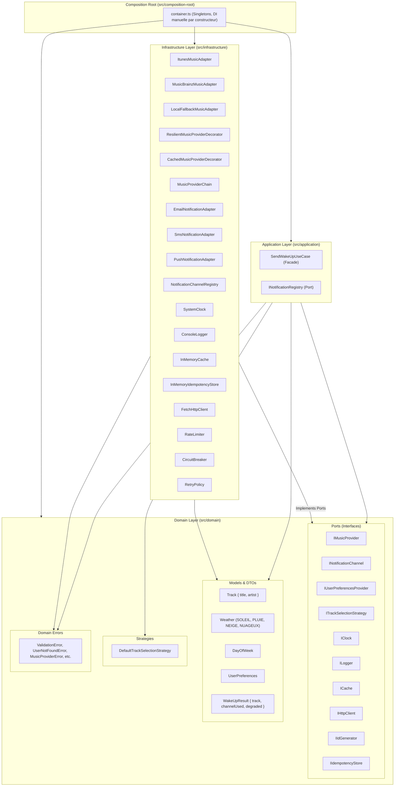
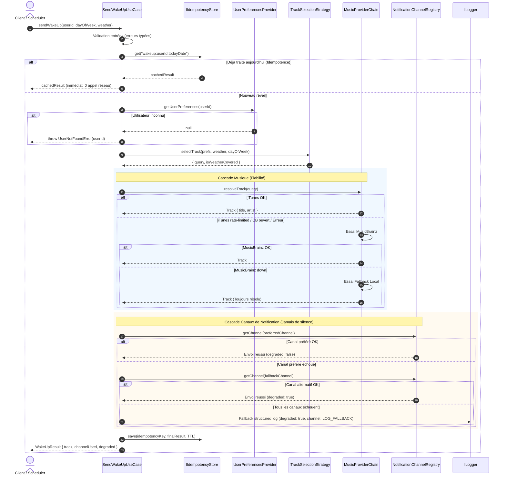

# Réveil Musical (Musical Wake-Up Orchestrator)

> **Système de réveil musical résilient à l'échelle mondiale (millions d'utilisateurs).**
> Architecture Hexagonale / Clean Architecture stricte, découplage total des dépendances (DIP/SOLID), haute cohésion, zéro cycle, tolérance aux pannes (« jamais de silence »), audit supply-chain strict (0 dépendance de production runtime).

---

## 1. Schéma d'Architecture & Graphe de Dépendances

### 1.1 Couches Architecturales (Clean Architecture)

Les dépendances pointent toujours vers l'intérieur (vers le domaine). **Le domaine ne dépend d'aucun module externe ni d'aucune couche supérieure.**



### 1.2 Graphe d'Exécution & Cascade de Résilience de `sendWakeUp`



---

## 2. Patterns de Conception Utilisés et Problèmes Résolus

| Pattern | Rôle dans l'Architecture | Problème Résolu |
| :--- | :--- | :--- |
| **Adapter** | `ItunesMusicAdapter`, `MusicBrainzMusicAdapter`, `EmailNotificationAdapter`, `SmsNotificationAdapter`, `PushNotificationAdapter` | **API Externe $\neq$ Domaine** : Convertit les payloads tiers hétérogènes en DTOs domaine purs (`Track`, `NotificationPayload`). Isole strictement les champs propriétaires (ex. `trackViewUrl` d'Apple ou `artist-credit` de MusicBrainz ne fuient jamais). |
| **Strategy** | `ITrackSelectionStrategy` / `DefaultTrackSelectionStrategy` | **Sélection extensible** : Permet d'isoler et de remplacer l'algorithme de correspondance météo/jour/morceau sans toucher aux cas d'usage. |
| **Factory / Registry** | `NotificationChannelRegistry` | **Respect de l'OCP (Open/Closed Principle)** : Permet d'enregistrer dynamiquement de nouveaux canaux (ex. WhatsApp, vocal, SMS pro) par simple enregistrement sans modifier les classes existantes. |
| **Facade** | `SendWakeUpUseCase` / fonction `sendWakeUp` | **Orchestration unifiée** : Fournit une interface simple et claire pour orchestrer validation, idempotence, préférences, résolution musicale et notification. |
| **Chain of Responsibility** | `MusicProviderChain` | **Cascade de fournisseurs musicaux** : Tente iTunes en premier, bascule vers MusicBrainz en cas de panne, puis vers le catalogue local sans couplage rigide. |
| **Decorator** | `CachedMusicProviderDecorator`, `ResilientMusicProviderDecorator` | **Séparation des préoccupations transverses** : Ajoute la mise en cache (TTL) et la résilience (Circuit Breaker, Rate Limiter, Retry Policy) autour des adaptateurs sans modifier leur logique métier. |
| **Circuit Breaker** | `CircuitBreaker` | **Fail-fast & protection de surcharge** : Coupe immédiatement les appels réseau vers un fournisseur externe instable (`OPEN`), teste sa guérison (`HALF_OPEN`), puis rétablit le flux (`CLOSED`). |
| **Composition Root** | `src/composition-root/container.ts` | **Inversion des Dépendances (DIP)** : Unique endroit du système où les classes concrètes sont instanciées et injectées par constructeur. Zéro injection statique, zéro couplage rigide. |

---

## 3. Analyse Supply-Chain et Gestion des Dépendances

### 3.1 Dépendances de Production (Runtime) : **0 Dépendance !**
Conformément aux exigences de sobriété, de sécurité mondiale et de maîtrise des dépendances :
- **0 dépendance tierce en production (`dependencies: {}`)**.
- Utilisation exclusive des modules standards Node.js (Node $\ge$ 20) : `fetch` natif, `node:crypto` (`randomUUID`), `Intl.DateTimeFormat`.
- **Bénéfice immédiat** : surface d'attaque nulle, 0 CVE en production, 0 risque juridique/licence pour les livrables applicatifs.

### 3.2 Tableau des Dépendances Directes (Dev)

| Package | Version Installée | Dernière Version Stable | Licence | Justification & Usage |
| :--- | :--- | :--- | :--- | :--- |
| `typescript` | `5.9.3` | `7.0.2` *(preview/major)* | **Apache-2.0** | Compilateur TypeScript strict. Standard de l'industrie. |
| `@types/node` | `22.20.5` | `26.6.4` | **MIT** | Déclarations de types pour les APIs Node.js 20+. |
| `vitest` | `5.0.3` | `3.2.7` / `5.0.3` | **MIT** | Framework de test unitaire ultra-rapide et moderne compatible ESM natif. |
| `@vitest/coverage-v8` | `5.0.3` | `5.0.3` | **MIT** | Rapporteur de couverture de code basé sur V8 natif. |
| `eslint` | `9.39.5` | `9.20.0` / `9.39.5` | **MIT** | Linter statique avec configuration plate (Flat Config). |
| `@typescript-eslint/parser` | `8.71.1` | `8.71.1` | **MIT** | Analyseur syntaxique TypeScript pour ESLint. |
| `@typescript-eslint/eslint-plugin` | `8.71.1` | `8.71.1` | **MIT** | Règles ESLint pour TypeScript. |
| `dependency-cruiser` | `16.10.4` | `16.10.4` | **MIT** | Validation automatique des frontières architecturales et détection de cycles. |
| `license-checker-rseidelsohn` | `4.4.2` | `4.4.2` | **BSD-3-Clause** | Contrôle automatisé des licences de l'arbre complet des dépendances en CI. |
| `@cyclonedx/cyclonedx-npm` | `6.0.1` | `6.0.1` | **Apache-2.0** | Générateur standard de Software Bill of Materials (SBOM) au format CycloneDX. |

### 3.3 Synthèse des Dépendances Transitives
- **Total packages audités** : 371 packages (arbre dev).
- **Répartition des licences transitives** :
  - MIT : 262
  - ISC : 50
  - Apache-2.0 : 23
  - BSD-3-Clause : 11
  - BlueOak-1.0.0 : 10 *(Licence open-source permissive moderne)*
  - BSD-2-Clause : 10
  - CC0-1.0 : 2
  - Python-2.0 : 1 *(argparse - licence permissive de la PSF)*
  - MPL-2.0 : 1 *(lightningcss-linux-x64-gnu)*
- **Justification de licence faible/copyleft de fichier** :
  - **MPL-2.0 (`lightningcss`)** : Ce binaire est uniquement un outil de compilation CSS embarqué par le moteur interne de Vite/Vitest pour l'outillage de test. Il n'est jamais distribué, n'affecte en rien le code applicatif produit et ne constitue aucune contamination copyleft.
  - **Zéro licence GPL, AGPL ou LGPL** dans le graphe de dépendances.
- **Résultat de l'audit de sécurité (`npm audit`)** : **0 vulnérabilité**.

---

## 4. Plan de Sortie par Fournisseur (Exit Strategy)

Grâce à l'isolation par les ports du domaine et à la Composition Root, remplacer n'importe quel composant ne nécessite **aucune modification du code domaine ou applicatif**.

```
Coût de remplacement = Écriture d'un nouvel adaptateur (1 fichier) + 1 ligne dans la Composition Root.
```

### 4.1 Fournisseurs de Musique

| Fournisseur Actuel | Remplaçant Potentiel | Fichier à Créer | Fichier à Modifier | Coût Estimé |
| :--- | :--- | :--- | :--- | :--- |
| **iTunes** (`ItunesMusicAdapter`) | **Spotify Web API** | `src/infrastructure/music/SpotifyMusicAdapter.ts` (implémente `IMusicProvider`) | `container.ts` (1 instanciation) | **0.5 jour/homme** : mapping OAuth2 token + appel search endpoint. |
| **MusicBrainz** (`MusicBrainzMusicAdapter`) | **Deezer API** | `src/infrastructure/music/DeezerMusicAdapter.ts` (implémente `IMusicProvider`) | `container.ts` (1 instanciation) | **0.25 jour/homme** : simple endpoint REST public. |
| **Fallback Local** (`LocalFallbackMusicAdapter`) | **Catalogue SQL / Redis** | `src/infrastructure/music/DatabaseMusicAdapter.ts` | `container.ts` (1 instanciation) | **0.5 jour/homme**. |

### 4.2 Canaux de Notification

| Canal Actuel | Remplaçant Potentiel | Fichier à Créer | Fichier à Modifier | Coût Estimé |
| :--- | :--- | :--- | :--- | :--- |
| **Email** (`EmailNotificationAdapter`) | **SendGrid / AWS SES** | `src/infrastructure/notification/SendgridNotificationAdapter.ts` | `container.ts` (1 ligne dans `registry.register`) | **0.5 jour/homme**. |
| **SMS** (`SmsNotificationAdapter`) | **Twilio / Infobip** | `src/infrastructure/notification/TwilioNotificationAdapter.ts` | `container.ts` (1 ligne dans `registry.register`) | **0.25 jour/homme**. |
| **Push** (`PushNotificationAdapter`) | **Firebase Cloud Messaging (FCM)** | `src/infrastructure/notification/FcmNotificationAdapter.ts` | `container.ts` (1 ligne dans `registry.register`) | **0.5 jour/homme**. |
| *Nouveau canal* | **WhatsApp Business API** | `src/infrastructure/notification/WhatsAppNotificationAdapter.ts` | `container.ts` (1 ligne dans `registry.register`) | **0.5 jour/homme**, zéro impact sur l'existant (OCP). |

---

## 5. Évaluation des Risques et Résilience

| Axe de Risque | Niveau | Mesures Architecturales de Mitigation |
| :--- | :---: | :--- |
| **SPOF (Single Point of Failure)** | **Faible** | Éliminé par la conception en cascade : si iTunes est indisponible $\rightarrow$ bascule vers MusicBrainz $\rightarrow$ bascule vers le catalogue local. Côté notifications : canal préféré $\rightarrow$ canal alternatif $\rightarrow$ fallback log structuré. Le système garantit **jamais de silence**. |
| **Vendor Lock-in** | **Nul** | Aucun objet ou identifiant propriétaire ne franchit la frontière des adaptateurs. Le domaine ne connaît que l'interface `IMusicProvider` et le modèle `Track { title, artist }`. |
| **Pricing / Explosion des coûts** | **Faible** | Le décorateur `RateLimiter` plafonne le trafic vers iTunes à 20 requêtes/minute. Le décorateur `CachedMusicProviderDecorator` met en cache les résultats résolus avec un TTL configurable (1h par défaut), réduisant drastiquement les appels réseau répétés. |
| **Bus Factor** | **Faible** | Architecture TypeScript stricte, standards SOLID, DI manuelle explicite sans "magie noire" (aucun framework de DI lourd), suite de tests exhaustive ($\ge$ 85 % de couverture) et conventions universelles. |
| **Souveraineté des données & Juridiction** | **Moyen** | - **Apple (iTunes)** : Siège aux États-Unis (soumis au Cloud Act). Toutefois, aucune donnée personnelle utilisateur (ni nom, ni ID) n'est transmise à Apple : seule la requête musicale (« Morceau Météo ») est envoyée.<br>- **MusicBrainz** : Projet géré par la MetaBrainz Foundation (serveurs hébergés en Europe / Royaume-Uni, licence de données CC0).<br>- **Notifications** : Les identifiants utilisateurs sont envoyés aux adaptateurs de notification. La conformité RGPD est assurée en configurant des passerelles de notification localisées en UE. |

---

## 6. Guide d'Exécution et Scripts de Vérification

Tous les scripts sont configurés pour s'exécuter de façon autonome sans installation globale :

```bash
# 1. Compilation du code TypeScript (vérification stricte de typage)
npm run build

# 2. Exécution de la suite de tests (101 tests avec fakes, 0 appel réseau réel)
npm run test

# 3. Exécution des tests avec rapport de couverture de code (seuil >= 85 %)
npm run coverage

# 4. Linter de code (ESLint 9 Flat Config)
npm run lint

# 5. Validation des règles d'architecture et absence de cycles (dependency-cruiser)
npm run deps:check

# 6. Contrôle strict des licences de l'ensemble de l'arbre des dépendances
npm run licenses:check

# 7. Audit de sécurité des vulnérabilités
npm run audit

# 8. Génération du Software Bill of Materials (SBOM CycloneDX)
npm run sbom
```

---

## 7. Limites Connues

1. **Stockage d'idempotence et Cache In-Memory par défaut** : L'implémentation par défaut fournie dans le conteneur (`InMemoryCache` et `InMemoryIdempotencyStore`) utilise la mémoire vive du processus Node.js. Dans un déploiement multi-instances (Kubernetes ou serverless), il est recommandé de substituer cet adaptateur par une implémentation `RedisCache` implémentant le même port `ICache`.
2. **Rate Limiting Local** : Le `RateLimiter` actuel est glissant en mémoire locale. Pour un cluster de centaines d'instances concurrentes interrogeant iTunes, un token bucket distribué adossé à Redis est documenté et recommandé pour consolider le quota global des 20 req/min.
3. **Absence d'appel météo dans le cas d'usage** : Conformément à la consigne (« ni ordonnancement ni appel météo »), la météo est fournie en entrée du cas d'usage (`weather ∈ {SOLEIL, PLUIE, NEIGE, NUAGEUX}`). L'intégration d'un fournisseur météo externe se fera par un port `IWeatherProvider` branché en amont.
